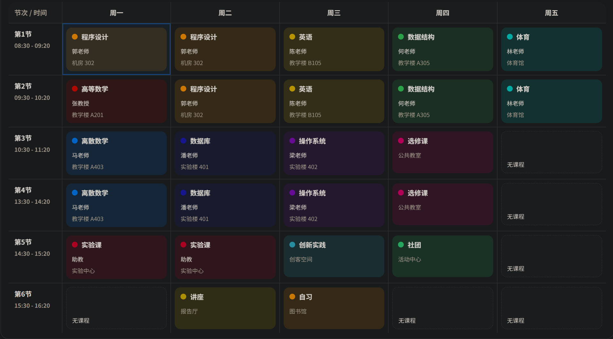

## 昆明城市学院 课表网站

制作一个简单的课表网站，用于查看昆明城市学院的课表。

### 网站设计

网站样式仿造 ，界面要美观

可以导入多个(上传文件/粘贴) JSON 数据，可自定义标题保存在 localStorage 中。


### 教学作息时间

JSON 数据 (JSON Data)

```json
{
  "title": "昆明城市学院教学作息时间表",
  "schedule": [
    {
      "period": "上午",
      "session": "第1-2节",
      "time": "08:30-09:50",
      "campus": null
    },
    {
      "period": "上午",
      "session": "课间休息",
      "time": "09:50-10:05",
      "campus": null
    },
    {
      "period": "上午",
      "session": "第3-4节",
      "time": "10:05-11:25",
      "campus": null
    },
    {
      "period": "中午",
      "session": "休息",
      "time": "11:25-12:00",
      "campus": null
    },
    {
      "period": "中午",
      "session": "中午上课",
      "time": "12:00-13:20",
      "campus": null
    },
    {
      "period": "下午",
      "session": "第5-6节",
      "time": "13:30-14:50",
      "campus": null
    },
    {
      "period": "下午",
      "session": "课间休息",
      "time": "14:50-15:05",
      "campus": null
    },
    {
      "period": "下午",
      "session": "第7-8节",
      "time": "15:05-16:25",
      "campus": null
    },
    {
      "period": "运动时间",
      "session": null,
      "time": "16:30-17:30",
      "campus": null
    },
    {
      "period": "休息",
      "session": null,
      "time": "17:30-18:50",
      "campus": "海源校区"
    },
    {
      "period": "休息",
      "session": null,
      "time": "17:30-18:20",
      "campus": "杨林校区"
    },
    {
      "period": "晚上",
      "session": "第9-10节",
      "time": "19:00-20:20",
      "campus": "海源校区"
    },
    {
      "period": "晚上",
      "session": "第9-10节",
      "time": "18:30-19:50",
      "campus": "杨林校区"
    },
    {
      "period": "晚上",
      "session": "课间休息",
      "time": "20:20-20:30",
      "campus": "海源校区"
    },
    {
      "period": "晚上",
      "session": "课间休息",
      "time": "19:50-20:00",
      "campus": "杨林校区"
    },
    {
      "period": "晚上",
      "session": "第11-12节",
      "time": "20:30-21:50",
      "campus": "海源校区"
    },
    {
      "period": "晚上",
      "session": "第11-12节",
      "time": "20:00-21:20",
      "campus": "杨林校区"
    }
  ]
}
```


JSON Schema

```json
{
  "$schema": "http://json-schema.org/draft-07/schema#",
  "title": "教学作息时间表",
  "type": "object",
  "properties": {
    "title": {
      "type": "string",
      "description": "表格的标题"
    },
    "schedule": {
      "type": "array",
      "description": "作息时间安排列表",
      "items": {
        "type": "object",
        "properties": {
          "period": {
            "type": "string",
            "description": "时段（如：上午、中午、下午、晚上等）",
            "enum": [
              "上午",
              "中午",
              "下午",
              "运动时间",
              "休息",
              "晚上"
            ]
          },
          "session": {
            "type": ["string", "null"],
            "description": "上课节次或活动内容（如：第1-2节、课间休息等）。如无特定节次则为null。"
          },
          "time": {
            "type": "string",
            "description": "时间段，格式为 HH:MM-HH:MM",
            "pattern": "^([01]?[0-9]|2[0-3]):[0-5][0-9]-([01]?[0-9]|2[0-3]):[0-5][0-9]$"
          },
          "campus": {
            "type": ["string", "null"],
            "description": "适用校区（如：海源校区、杨林校区）。如不分校区则为null。"
          }
        },
        "required": [
          "period",
          "session",
          "time",
          "campus"
        ],
        "additionalProperties": false
      }
    }
  },
  "required": [
    "title",
    "schedule"
  ],
  "additionalProperties": false
}
```

### 课程表 (JSON Data)


JSON Schema

```json
{
  "$schema": "http://json-schema.org/draft-07/schema#",
  "title": "课程表 Schema",
  "type": "object",
  "required": [
    "xnxq",
    "zc",
    "days",
    "courses",
    "timetable",
    "remark"
  ],
  "properties": {
    "xnxq": {
      "type": "string",
      "description": "学期，例如：2026-2027-1"
    },
    "zc": {
      "type": "string",
      "description": "周次，例如：(全部)"
    },
    "days": {
      "type": "array",
      "description": "星期列表",
      "items": {
        "$ref": "#/definitions/Weekday"
      }
    },
    "courses": {
      "type": "array",
      "description": "课程列表",
      "items": {
        "$ref": "#/definitions/CourseEntry"
      }
    },
    "timetable": {
      "type": "object",
      "description": "按大节和星期组织的课程表",
      "additionalProperties": {
        "type": "object",
        "propertyNames": {
          "$ref": "#/definitions/Weekday"
        },
        "additionalProperties": {
          "type": "array",
          "items": {
            "$ref": "#/definitions/Course"
          }
        }
      }
    },
    "remark": {
      "type": "string",
      "description": "备注信息"
    }
  },
  "definitions": {
    "Weekday": {
      "type": "string",
      "enum": [
        "星期一",
        "星期二",
        "星期三",
        "星期四",
        "星期五",
        "星期六",
        "星期日"
      ]
    },
    "Course": {
      "type": "object",
      "required": [
        "courseName",
        "courseTitle",
        "teacher",
        "className",
        "weeks",
        "periods",
        "weeksAndPeriods",
        "location",
        "raw"
      ],
      "properties": {
        "courseName": {
          "type": "string"
        },
        "courseTitle": {
          "type": "string"
        },
        "teacher": {
          "type": "string"
        },
        "className": {
          "type": "string"
        },
        "weeks": {
          "type": "string"
        },
        "periods": {
          "type": "string"
        },
        "weeksAndPeriods": {
          "type": "string"
        },
        "location": {
          "type": "string"
        },
        "raw": {
          "type": "string"
        }
      },
      "additionalProperties": false
    },
    "CourseEntry": {
      "type": "object",
      "required": [
        "section",
        "day",
        "courseName",
        "courseTitle",
        "teacher",
        "className",
        "weeks",
        "periods",
        "weeksAndPeriods",
        "location",
        "raw"
      ],
      "properties": {
        "section": {
          "type": "string",
          "description": "大节，例如：第1大节"
        },
        "day": {
          "$ref": "#/definitions/Weekday"
        },
        "courseName": {
          "type": "string"
        },
        "courseTitle": {
          "type": "string"
        },
        "teacher": {
          "type": "string"
        },
        "className": {
          "type": "string"
        },
        "weeks": {
          "type": "string"
        },
        "periods": {
          "type": "string"
        },
        "weeksAndPeriods": {
          "type": "string"
        },
        "location": {
          "type": "string"
        },
        "raw": {
          "type": "string"
        }
      },
      "additionalProperties": false
    }
  }
}
```

example

```json
{
  "xnxq": "2026-2027-1",
  "zc": "(全部)",
  "days": [
    "星期一",
    "星期二",
    "星期三",
    "星期四",
    "星期五",
    "星期六",
    "星期日"
  ],
  "courses": [
    {
      "section": "第1大节",
      "day": "星期一",
      "courseName": "管理学概论",
      "courseTitle": "管理学概论[32][必修]",
      "teacher": "高翔（数工）讲师（高校）",
      "className": "26计算机科学与技术4班，26计算机科学与技术8班",
      "weeks": "4-19(全部)",
      "periods": "01-02节",
      "weeksAndPeriods": "(110)4-19(全部)[01-02节]",
      "location": "致远楼404",
      "raw": "管理学概论[32][必修]高翔（数工）讲师（高校）26计算机科学与技术4班，26计算机科学与技术8班(110)4-19(全部)[01-02节]致远楼404"
    },
    {
      "section": "第1大节",
      "day": "星期二",
      "courseName": "程序设计基础",
      "courseTitle": "程序设计基础[64][必修]",
      "teacher": "待定52",
      "className": "26计算机科学与技术8班",
      "weeks": "6-19(全部)",
      "periods": "01-02节",
      "weeksAndPeriods": "(56)6-19(全部)[01-02节]",
      "location": "惟志楼507",
      "raw": "程序设计基础[64][必修]待定5226计算机科学与技术8班(56)6-19(全部)[01-02节]惟志楼507"
    },
    {
      "section": "第1大节",
      "day": "星期三",
      "courseName": "大学体育（1）",
      "courseTitle": "大学体育（1）[32][必修]",
      "teacher": "黄思琦助教",
      "className": "26计算机科学与技术8班",
      "weeks": "4-19(全部)",
      "periods": "01-02节",
      "weeksAndPeriods": "(56)4-19(全部)[01-02节]",
      "location": "篮球场1（杨林）",
      "raw": "大学体育（1）[32][必修]黄思琦助教26计算机科学与技术8班(56)4-19(全部)[01-02节]篮球场1（杨林）"
    },
    {
      "section": "第1大节",
      "day": "星期五",
      "courseName": "程序设计基础",
      "courseTitle": "程序设计基础[64][必修]",
      "teacher": "李亚东副教授",
      "className": "26计算机科学与技术8班",
      "weeks": "4-5(全部)",
      "periods": "01-02-03-04节",
      "weeksAndPeriods": "(56)4-5(全部)[01-02-03-04节]",
      "location": "惟志楼309信息安全实训室",
      "raw": "程序设计基础[64][必修]李亚东副教授26计算机科学与技术8班(56)4-5(全部)[01-02-03-04节]惟志楼309信息安全实训室"
    },
    {
      "section": "第2大节",
      "day": "星期二",
      "courseName": "程序设计基础",
      "courseTitle": "程序设计基础[64][必修]",
      "teacher": "待定52",
      "className": "26计算机科学与技术8班",
      "weeks": "6-19(全部)",
      "periods": "03-04节",
      "weeksAndPeriods": "(56)6-19(全部)[03-04节]",
      "location": "致远楼306",
      "raw": "程序设计基础[64][必修]待定5226计算机科学与技术8班(56)6-19(全部)[03-04节]致远楼306"
    },
    {
      "section": "第2大节",
      "day": "星期四",
      "courseName": "计算机科学与技术专业概论",
      "courseTitle": "计算机科学与技术专业概论[32][必修]",
      "teacher": "待定103",
      "className": "26计算机科学与技术8班",
      "weeks": "6-19(全部)",
      "periods": "03-04节",
      "weeksAndPeriods": "(56)6-19(全部)[03-04节]",
      "location": "惟志楼506",
      "raw": "计算机科学与技术专业概论[32][必修]待定10326计算机科学与技术8班(56)6-19(全部)[03-04节]惟志楼506"
    },
    {
      "section": "第2大节",
      "day": "星期五",
      "courseName": "程序设计基础",
      "courseTitle": "程序设计基础[64][必修]",
      "teacher": "李亚东副教授",
      "className": "26计算机科学与技术8班",
      "weeks": "4-5(全部)",
      "periods": "01-02-03-04节",
      "weeksAndPeriods": "(56)4-5(全部)[01-02-03-04节]",
      "location": "惟志楼309信息安全实训室",
      "raw": "程序设计基础[64][必修]李亚东副教授26计算机科学与技术8班(56)4-5(全部)[01-02-03-04节]惟志楼309信息安全实训室"
    },
    {
      "section": "第3大节",
      "day": "星期二",
      "courseName": "高等数学（1）",
      "courseTitle": "高等数学（1）[96][必修]",
      "teacher": "蒋耀霞",
      "className": "26计算机科学与技术4班，26计算机科学与技术8班",
      "weeks": "4-19(全部)",
      "periods": "05-06-07-08节",
      "weeksAndPeriods": "(110)4-19(全部)[05-06-07-08节]",
      "location": "勤敏楼104",
      "raw": "高等数学（1）[96][必修]蒋耀霞26计算机科学与技术4班，26计算机科学与技术8班(110)4-19(全部)[05-06-07-08节]勤敏楼104"
    },
    {
      "section": "第3大节",
      "day": "星期四",
      "courseName": "计算机科学与技术专业概论",
      "courseTitle": "计算机科学与技术专业概论[32][必修]",
      "teacher": "王钟浩讲师（高校）",
      "className": "26计算机科学与技术8班",
      "weeks": "4-5(全部)",
      "periods": "05-06节",
      "weeksAndPeriods": "(56)4-5(全部)[05-06节]",
      "location": "致远楼202",
      "raw": "计算机科学与技术专业概论[32][必修]王钟浩讲师（高校）26计算机科学与技术8班(56)4-5(全部)[05-06节]致远楼202"
    },
    {
      "section": "第3大节",
      "day": "星期五",
      "courseName": "高等数学（1）",
      "courseTitle": "高等数学（1）[96][必修]",
      "teacher": "蒋耀霞",
      "className": "26计算机科学与技术4班，26计算机科学与技术8班",
      "weeks": "4-19(全部)",
      "periods": "05-06节",
      "weeksAndPeriods": "(110)4-19(全部)[05-06节]",
      "location": "致远楼404",
      "raw": "高等数学（1）[96][必修]蒋耀霞26计算机科学与技术4班，26计算机科学与技术8班(110)4-19(全部)[05-06节]致远楼404"
    },
    {
      "section": "第4大节",
      "day": "星期二",
      "courseName": "高等数学（1）",
      "courseTitle": "高等数学（1）[96][必修]",
      "teacher": "蒋耀霞",
      "className": "26计算机科学与技术4班，26计算机科学与技术8班",
      "weeks": "4-19(全部)",
      "periods": "05-06-07-08节",
      "weeksAndPeriods": "(110)4-19(全部)[05-06-07-08节]",
      "location": "勤敏楼104",
      "raw": "高等数学（1）[96][必修]蒋耀霞26计算机科学与技术4班，26计算机科学与技术8班(110)4-19(全部)[05-06-07-08节]勤敏楼104"
    },
    {
      "section": "第4大节",
      "day": "星期四",
      "courseName": "思想道德与法治",
      "courseTitle": "思想道德与法治[32][必修]",
      "teacher": "李晶（马院）讲师（高校）",
      "className": "26计算机科学与技术8班，26财务管理1班",
      "weeks": "4-19(全部)",
      "periods": "07-08节",
      "weeksAndPeriods": "(99)4-19(全部)[07-08节]",
      "location": "致远楼303",
      "raw": "思想道德与法治[32][必修]李晶（马院）讲师（高校）26计算机科学与技术8班，26财务管理1班(99)4-19(全部)[07-08节]致远楼303"
    },
    {
      "section": "第5大节",
      "day": "星期一",
      "courseName": "大学外语（1）",
      "courseTitle": "大学外语（1）[64][必修]",
      "teacher": "刘婷婷副教授",
      "className": "26计算机科学与技术8班",
      "weeks": "4-19(全部)",
      "periods": "09-10节",
      "weeksAndPeriods": "(56)4-19(全部)[09-10节]",
      "location": "国际楼403",
      "raw": "大学外语（1）[64][必修]刘婷婷副教授26计算机科学与技术8班(56)4-19(全部)[09-10节]国际楼403"
    },
    {
      "section": "第5大节",
      "day": "星期二",
      "courseName": "形势与政策（1）",
      "courseTitle": "形势与政策（1）[8][必修]",
      "teacher": "何可人讲师（高校）",
      "className": "26计算机科学与技术8班，26财务管理1班",
      "weeks": "13-16(全部)",
      "periods": "09-10节",
      "weeksAndPeriods": "(99)13-16(全部)[09-10节]",
      "location": "笃学楼301",
      "raw": "形势与政策（1）[8][必修]何可人讲师（高校）26计算机科学与技术8班，26财务管理1班(99)13-16(全部)[09-10节]笃学楼301"
    },
    {
      "section": "第5大节",
      "day": "星期三",
      "courseName": "大学外语（1）",
      "courseTitle": "大学外语（1）[64][必修]",
      "teacher": "刘婷婷副教授",
      "className": "26计算机科学与技术8班",
      "weeks": "4-19(全部)",
      "periods": "09-10节",
      "weeksAndPeriods": "(56)4-19(全部)[09-10节]",
      "location": "惟志楼303",
      "raw": "大学外语（1）[64][必修]刘婷婷副教授26计算机科学与技术8班(56)4-19(全部)[09-10节]惟志楼303"
    },
    {
      "section": "第5大节",
      "day": "星期四",
      "courseName": "国家安全教育",
      "courseTitle": "国家安全教育[16][必修]",
      "teacher": "张树梅副教授,王其川副教授,吕丹讲师（高校）,郭慧芳副教授",
      "className": "26计算机科学与技术[5-8]班",
      "weeks": "11-14(全部)",
      "periods": "09-10节",
      "weeksAndPeriods": "(217)11-14(全部)[09-10节]",
      "location": "文心楼401",
      "raw": "国家安全教育[16][必修]张树梅副教授,王其川副教授,吕丹讲师（高校）,郭慧芳副教授26计算机科学与技术[5-8]班(217)11-14(全部)[09-10节]文心楼401"
    },
    {
      "section": "第6大节",
      "day": "星期三",
      "courseName": "大学生心理健康",
      "courseTitle": "大学生心理健康[32][必修]",
      "teacher": "刘佳未评级",
      "className": "大学生心理健康杨林11班",
      "weeks": "7-14(全部)",
      "periods": "11-12节",
      "weeksAndPeriods": "(230)7-14(全部)[11-12节]",
      "location": "国际楼1号报告厅",
      "raw": "大学生心理健康[32][必修]刘佳未评级大学生心理健康杨林11班(230)7-14(全部)[11-12节]国际楼1号报告厅"
    }
  ],
  "timetable": {
    "第1大节": {
      "星期一": [
        {
          "courseName": "管理学概论",
          "courseTitle": "管理学概论[32][必修]",
          "teacher": "高翔（数工）讲师（高校）",
          "className": "26计算机科学与技术4班，26计算机科学与技术8班",
          "weeks": "4-19(全部)",
          "periods": "01-02节",
          "weeksAndPeriods": "(110)4-19(全部)[01-02节]",
          "location": "致远楼404",
          "raw": "管理学概论[32][必修]高翔（数工）讲师（高校）26计算机科学与技术4班，26计算机科学与技术8班(110)4-19(全部)[01-02节]致远楼404"
        }
      ],
      "星期二": [
        {
          "courseName": "程序设计基础",
          "courseTitle": "程序设计基础[64][必修]",
          "teacher": "待定52",
          "className": "26计算机科学与技术8班",
          "weeks": "6-19(全部)",
          "periods": "01-02节",
          "weeksAndPeriods": "(56)6-19(全部)[01-02节]",
          "location": "惟志楼507",
          "raw": "程序设计基础[64][必修]待定5226计算机科学与技术8班(56)6-19(全部)[01-02节]惟志楼507"
        }
      ],
      "星期三": [
        {
          "courseName": "大学体育（1）",
          "courseTitle": "大学体育（1）[32][必修]",
          "teacher": "黄思琦助教",
          "className": "26计算机科学与技术8班",
          "weeks": "4-19(全部)",
          "periods": "01-02节",
          "weeksAndPeriods": "(56)4-19(全部)[01-02节]",
          "location": "篮球场1（杨林）",
          "raw": "大学体育（1）[32][必修]黄思琦助教26计算机科学与技术8班(56)4-19(全部)[01-02节]篮球场1（杨林）"
        }
      ],
      "星期五": [
        {
          "courseName": "程序设计基础",
          "courseTitle": "程序设计基础[64][必修]",
          "teacher": "李亚东副教授",
          "className": "26计算机科学与技术8班",
          "weeks": "4-5(全部)",
          "periods": "01-02-03-04节",
          "weeksAndPeriods": "(56)4-5(全部)[01-02-03-04节]",
          "location": "惟志楼309信息安全实训室",
          "raw": "程序设计基础[64][必修]李亚东副教授26计算机科学与技术8班(56)4-5(全部)[01-02-03-04节]惟志楼309信息安全实训室"
        }
      ]
    },
    "第2大节": {
      "星期二": [
        {
          "courseName": "程序设计基础",
          "courseTitle": "程序设计基础[64][必修]",
          "teacher": "待定52",
          "className": "26计算机科学与技术8班",
          "weeks": "6-19(全部)",
          "periods": "03-04节",
          "weeksAndPeriods": "(56)6-19(全部)[03-04节]",
          "location": "致远楼306",
          "raw": "程序设计基础[64][必修]待定5226计算机科学与技术8班(56)6-19(全部)[03-04节]致远楼306"
        }
      ],
      "星期四": [
        {
          "courseName": "计算机科学与技术专业概论",
          "courseTitle": "计算机科学与技术专业概论[32][必修]",
          "teacher": "待定103",
          "className": "26计算机科学与技术8班",
          "weeks": "6-19(全部)",
          "periods": "03-04节",
          "weeksAndPeriods": "(56)6-19(全部)[03-04节]",
          "location": "惟志楼506",
          "raw": "计算机科学与技术专业概论[32][必修]待定10326计算机科学与技术8班(56)6-19(全部)[03-04节]惟志楼506"
        }
      ],
      "星期五": [
        {
          "courseName": "程序设计基础",
          "courseTitle": "程序设计基础[64][必修]",
          "teacher": "李亚东副教授",
          "className": "26计算机科学与技术8班",
          "weeks": "4-5(全部)",
          "periods": "01-02-03-04节",
          "weeksAndPeriods": "(56)4-5(全部)[01-02-03-04节]",
          "location": "惟志楼309信息安全实训室",
          "raw": "程序设计基础[64][必修]李亚东副教授26计算机科学与技术8班(56)4-5(全部)[01-02-03-04节]惟志楼309信息安全实训室"
        }
      ]
    },
    "第3大节": {
      "星期二": [
        {
          "courseName": "高等数学（1）",
          "courseTitle": "高等数学（1）[96][必修]",
          "teacher": "蒋耀霞",
          "className": "26计算机科学与技术4班，26计算机科学与技术8班",
          "weeks": "4-19(全部)",
          "periods": "05-06-07-08节",
          "weeksAndPeriods": "(110)4-19(全部)[05-06-07-08节]",
          "location": "勤敏楼104",
          "raw": "高等数学（1）[96][必修]蒋耀霞26计算机科学与技术4班，26计算机科学与技术8班(110)4-19(全部)[05-06-07-08节]勤敏楼104"
        }
      ],
      "星期四": [
        {
          "courseName": "计算机科学与技术专业概论",
          "courseTitle": "计算机科学与技术专业概论[32][必修]",
          "teacher": "王钟浩讲师（高校）",
          "className": "26计算机科学与技术8班",
          "weeks": "4-5(全部)",
          "periods": "05-06节",
          "weeksAndPeriods": "(56)4-5(全部)[05-06节]",
          "location": "致远楼202",
          "raw": "计算机科学与技术专业概论[32][必修]王钟浩讲师（高校）26计算机科学与技术8班(56)4-5(全部)[05-06节]致远楼202"
        }
      ],
      "星期五": [
        {
          "courseName": "高等数学（1）",
          "courseTitle": "高等数学（1）[96][必修]",
          "teacher": "蒋耀霞",
          "className": "26计算机科学与技术4班，26计算机科学与技术8班",
          "weeks": "4-19(全部)",
          "periods": "05-06节",
          "weeksAndPeriods": "(110)4-19(全部)[05-06节]",
          "location": "致远楼404",
          "raw": "高等数学（1）[96][必修]蒋耀霞26计算机科学与技术4班，26计算机科学与技术8班(110)4-19(全部)[05-06节]致远楼404"
        }
      ]
    },
    "第4大节": {
      "星期二": [
        {
          "courseName": "高等数学（1）",
          "courseTitle": "高等数学（1）[96][必修]",
          "teacher": "蒋耀霞",
          "className": "26计算机科学与技术4班，26计算机科学与技术8班",
          "weeks": "4-19(全部)",
          "periods": "05-06-07-08节",
          "weeksAndPeriods": "(110)4-19(全部)[05-06-07-08节]",
          "location": "勤敏楼104",
          "raw": "高等数学（1）[96][必修]蒋耀霞26计算机科学与技术4班，26计算机科学与技术8班(110)4-19(全部)[05-06-07-08节]勤敏楼104"
        }
      ],
      "星期四": [
        {
          "courseName": "思想道德与法治",
          "courseTitle": "思想道德与法治[32][必修]",
          "teacher": "李晶（马院）讲师（高校）",
          "className": "26计算机科学与技术8班，26财务管理1班",
          "weeks": "4-19(全部)",
          "periods": "07-08节",
          "weeksAndPeriods": "(99)4-19(全部)[07-08节]",
          "location": "致远楼303",
          "raw": "思想道德与法治[32][必修]李晶（马院）讲师（高校）26计算机科学与技术8班，26财务管理1班(99)4-19(全部)[07-08节]致远楼303"
        }
      ]
    },
    "第5大节": {
      "星期一": [
        {
          "courseName": "大学外语（1）",
          "courseTitle": "大学外语（1）[64][必修]",
          "teacher": "刘婷婷副教授",
          "className": "26计算机科学与技术8班",
          "weeks": "4-19(全部)",
          "periods": "09-10节",
          "weeksAndPeriods": "(56)4-19(全部)[09-10节]",
          "location": "国际楼403",
          "raw": "大学外语（1）[64][必修]刘婷婷副教授26计算机科学与技术8班(56)4-19(全部)[09-10节]国际楼403"
        }
      ],
      "星期二": [
        {
          "courseName": "形势与政策（1）",
          "courseTitle": "形势与政策（1）[8][必修]",
          "teacher": "何可人讲师（高校）",
          "className": "26计算机科学与技术8班，26财务管理1班",
          "weeks": "13-16(全部)",
          "periods": "09-10节",
          "weeksAndPeriods": "(99)13-16(全部)[09-10节]",
          "location": "笃学楼301",
          "raw": "形势与政策（1）[8][必修]何可人讲师（高校）26计算机科学与技术8班，26财务管理1班(99)13-16(全部)[09-10节]笃学楼301"
        }
      ],
      "星期三": [
        {
          "courseName": "大学外语（1）",
          "courseTitle": "大学外语（1）[64][必修]",
          "teacher": "刘婷婷副教授",
          "className": "26计算机科学与技术8班",
          "weeks": "4-19(全部)",
          "periods": "09-10节",
          "weeksAndPeriods": "(56)4-19(全部)[09-10节]",
          "location": "惟志楼303",
          "raw": "大学外语（1）[64][必修]刘婷婷副教授26计算机科学与技术8班(56)4-19(全部)[09-10节]惟志楼303"
        }
      ],
      "星期四": [
        {
          "courseName": "国家安全教育",
          "courseTitle": "国家安全教育[16][必修]",
          "teacher": "张树梅副教授,王其川副教授,吕丹讲师（高校）,郭慧芳副教授",
          "className": "26计算机科学与技术[5-8]班",
          "weeks": "11-14(全部)",
          "periods": "09-10节",
          "weeksAndPeriods": "(217)11-14(全部)[09-10节]",
          "location": "文心楼401",
          "raw": "国家安全教育[16][必修]张树梅副教授,王其川副教授,吕丹讲师（高校）,郭慧芳副教授26计算机科学与技术[5-8]班(217)11-14(全部)[09-10节]文心楼401"
        }
      ]
    },
    "第6大节": {
      "星期三": [
        {
          "courseName": "大学生心理健康",
          "courseTitle": "大学生心理健康[32][必修]",
          "teacher": "刘佳未评级",
          "className": "大学生心理健康杨林11班",
          "weeks": "7-14(全部)",
          "periods": "11-12节",
          "weeksAndPeriods": "(230)7-14(全部)[11-12节]",
          "location": "国际楼1号报告厅",
          "raw": "大学生心理健康[32][必修]刘佳未评级大学生心理健康杨林11班(230)7-14(全部)[11-12节]国际楼1号报告厅"
        }
      ]
    }
  },
  "remark": "军事技能训练 4-19周;专业认知实习 4-19周;大学体育（1） 黄思琦 4-19周;思想道德与法治（实践课） 李晶（马院） 4-19周;"
}
```

导出课表的代码

在网站 http://jw.kmcc.edu.cn/ynsfdxsxy_jsxsd/xskb/xskb_list.do 中，运行下列代码导出课表的 JSON 数据。

```javascript
function exportKbTableToJson() {
  const form = document.querySelector('#Form1');
  if (!form) throw new Error('未找到 #Form1');

  const table = form.querySelector('#kbtable');
  if (!table) throw new Error('未找到 #kbtable');

  // 当前学年学期、周次
  const xnxq = form.querySelector('#xnxq01id')?.selectedOptions?.[0]?.textContent?.trim() || '';
  const zc = form.querySelector('#zc')?.selectedOptions?.[0]?.textContent?.trim() || '';

  // 表头：星期一 ~ 星期日
  const days = Array.from(table.rows[0].cells)
    .slice(1)
    .map(cell => cell.textContent.trim())
    .filter(Boolean);

  const courses = [];
  let remark = '';

  for (let r = 1; r < table.rows.length; r++) {
    const row = table.rows[r];
    const th = row.cells[0];
    if (!th) continue;

    const section = th.textContent.replace(/\s+/g, ' ').trim();

    // 备注行
    if (section.includes('备注')) {
      remark = row.cells[1]?.textContent.replace(/\s+/g, ' ').trim() || '';
      continue;
    }

    // 第 1 个 cell 是节次，后面是星期一到星期日
    for (let c = 1; c < row.cells.length; c++) {
      const td = row.cells[c];
      const day = days[c - 1] || `星期${c}`;

      // 只取详细课表内容 .kbcontent，不取隐藏的 .kbcontent1
      td.querySelectorAll('.kbcontent').forEach(div => {
        const raw = div.textContent.replace(/\s+/g, ' ').trim();
        if (!raw || raw === '\u00a0') return;

        // 第一行课程标题，例如：管理学概论[32][必修]
        let courseTitle = '';
        for (const node of div.childNodes) {
          if (node.nodeType === Node.TEXT_NODE) {
            const t = node.textContent.trim();
            if (t) {
              courseTitle = t;
              break;
            }
          }
        }

        if (!courseTitle) {
          courseTitle = div.innerHTML.split('<br>')[0].replace(/<[^>]+>/g, '').trim();
        }

        const courseName = courseTitle.split('[')[0].trim();

        const teacher = div.querySelector('font[title="老师"]')?.textContent.trim() || '';
        const location = div.querySelector('font[title="上课地点"]')?.textContent.trim() || '';

        const classFont = div.querySelector('font[title="班级"]');
        let className = '';
        let weeksAndPeriods = '';

        if (classFont) {
          // 班级名通常在第一个文本节点
          for (const node of classFont.childNodes) {
            if (node.nodeType === Node.TEXT_NODE) {
              const t = node.textContent.trim();
              if (t) {
                className = t;
                break;
              }
            }
          }

          const span = classFont.querySelector('span[title="选课人数"]');
          weeksAndPeriods = (span ? span.textContent : classFont.textContent)
            .replace(/\s+/g, ' ')
            .trim();
        }

        // 解析周次和节次，例如：(110) 4-19(全部)[01-02节]
        let weeks = '';
        let periods = '';
        const wp = weeksAndPeriods.replace(/^\(\d+\)\s*/, ''); // 去掉选课人数
        const periodMatch = wp.match(/\[([^\]]+)\]/);

        if (periodMatch) {
          periods = periodMatch[1].trim();
          weeks = wp.replace(/\[[^\]]+\]/, '').trim();
        } else {
          weeks = wp;
        }

        courses.push({
          section,        // 第1大节 / 第2大节 / 早上 / 中午 / 晚上
          day,            // 星期一
          courseName,     // 管理学概论
          courseTitle,    // 管理学概论[32][必修]
          teacher,        // 高翔（数工）讲师（高校）
          className,      // 26计算机科学与技术4班，26计算机科学与技术8班
          weeks,          // 4-19(全部)
          periods,        // 01-02节
          weeksAndPeriods,// (110) 4-19(全部)[01-02节]
          location,       // 致远楼404
          raw             // 原始文本
        });
      });
    }
  }

  // 再生成一个按“大节 -> 星期”分组的矩阵，方便使用
  const timetable = {};
  for (const item of courses) {
    if (!timetable[item.section]) timetable[item.section] = {};
    if (!timetable[item.section][item.day]) timetable[item.section][item.day] = [];

    timetable[item.section][item.day].push({
      courseName: item.courseName,
      courseTitle: item.courseTitle,
      teacher: item.teacher,
      className: item.className,
      weeks: item.weeks,
      periods: item.periods,
      weeksAndPeriods: item.weeksAndPeriods,
      location: item.location,
      raw: item.raw
    });
  }

  return {
    xnxq,       // 学年学期
    zc,         // 周次
    days,       // 星期一 ~ 星期日
    courses,    // 扁平课程列表
    timetable,  // 按节次和星期分组的课程表
    remark      // 备注
  };
}

// 执行并导出 JSON
const data = exportKbTableToJson();
const json = JSON.stringify(data, null, 2);

console.log(json);

// 浏览器控制台里通常可以直接复制到剪贴板
copy(json);

// 如果 copy 不可用，可以用下面方式下载 JSON 文件：
// const blob = new Blob([json], { type: 'application/json' });
// const a = document.createElement('a');
// a.href = URL.createObjectURL(blob);
// a.download = '课表.json';
// a.click();
// URL.revokeObjectURL(a.href);
```